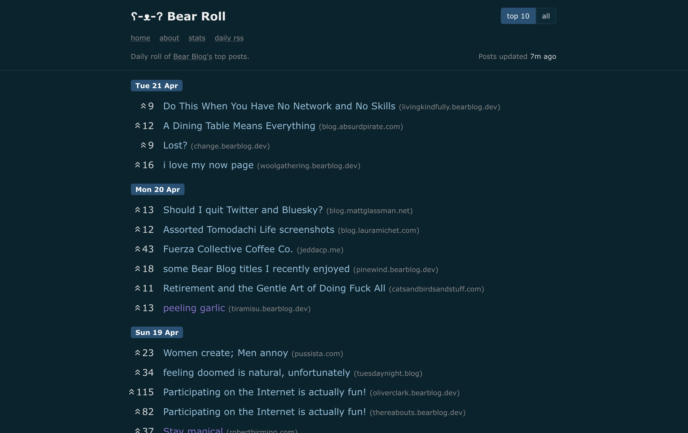

# Bear Roll

A daily roll of [Bear Blog's discover page](https://bearblog.dev/discover/).
Every hour, a Cloudflare Worker captures the top 100 posts and stores them as
dated JSON files. The result is a browsable, chronological record of what the
Bear Blog community has been reading and toasting.

Live at [bearroll.dev](https://bearroll.dev).



## How it works

**Collector** — A Cloudflare Worker (`worker/`) with an hourly Cron Trigger
scrapes the first 5 pages of Bear Blog's discover feed and commits updated
`data/YYYY-MM-DD.json` files to this repo through the GitHub API.

**Frontend** — A static [Astro](https://astro.build) site reads those JSON files
at build time. The first 4 days are server-rendered; older days load on scroll
via pre-built HTML fragment endpoints. Posts are ranked by toast count with top
10/all filter options. Styled with Tailwind v4, light and dark mode.

## Development

```sh
npm ci            # install dependencies
npm run dev       # start dev server
npm run build     # build static site to dist/
npm run preview   # preview the build
```

## License

MIT
